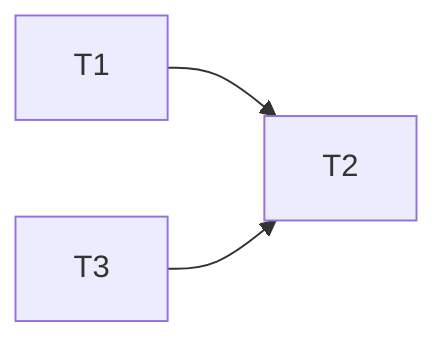

# kit plan

### T1 strings and symbols · Complexity 3
**Owns:** Sources/Kit/Strings.swift, Sources/Kit/ThemeSymbol.swift, Tests/KitTests/StringsTests.swift
**Produces:** Strings.libraryMoreTags(_ n: Int) -> String · Theme.Symbol.libraryTag
  e.g. Strings.libraryMoreTags(2) -> "+2"
  e.g. Theme.Symbol.libraryTag -> "tag"

### T2 library view · Complexity 3
**Owns:** Sources/Kit/Library.swift, Tests/KitTests/LibraryTests.swift
**Consumes:** Strings.libraryMoreTags(_ n: Int) -> String (T1)
**Produces:** Library.title

### T3 docs · Complexity 1
**Owns:** README.md
**Produces:** README section Tags

## Review Focus
- kit: state
