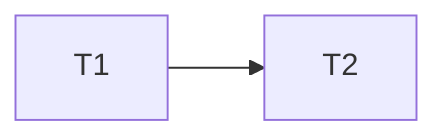

# kit plan

### T1 notifications · Complexity 3
**Owns:** Sources/Kit/Notifications.swift, Tests/KitTests/NotificationsTests.swift
**Produces:** NotificationPreferences.level(for: NotificationCategory) -> NotificationLevel

### T2 client · Complexity 3
**Owns:** Sources/Kit/Client.swift, Tests/KitTests/ClientTests.swift
**Consumes:** NotificationPreferences.level(for: NotificationCategory) -> NotificationLevel (T1)
**Produces:** Client.send(_ payload: Payload) -> Bool

## Review Focus
- kit: state
